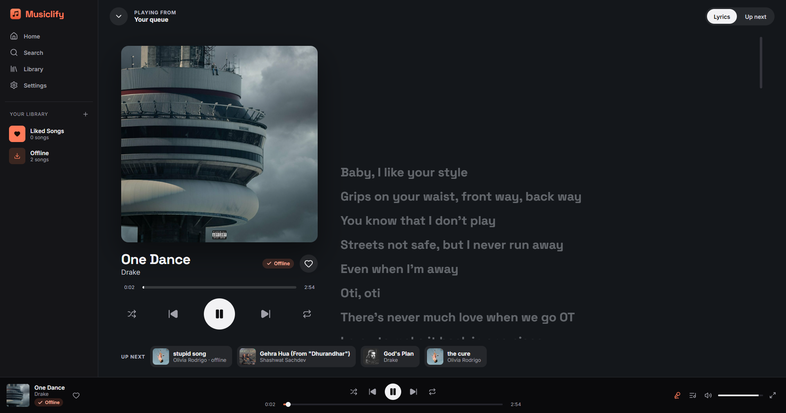

# Musiclify

[](https://github.com/reshuk-code/musiclify/actions/workflows/ci.yml)
[](https://github.com/reshuk-code/musiclify/releases)
[](LICENSE)

A local-first music player for **Android** and **Windows**. Search any song, sing along with synced lyrics, and keep an encrypted offline library on your own devices. No account, no ads, no tracking.

<p align="center">
  
</p>

> **Personal use only.** Musiclify streams audio from YouTube on your own device for personal listening. It does not host, redistribute, or share any audio. Respect copyright and YouTube's terms.

## Download

Get the latest Windows installer and Android APK from [Releases](https://github.com/reshuk-code/musiclify/releases).

## Features

- **Search any song** — metadata from Deezer, audio fetched from YouTube on-device
- **Synced lyrics** — scroll line-by-line, tap any line to jump (via LRCLIB)
- **Encrypted offline library** — songs saved AES-CTR encrypted with a device-held key; copied files won't play elsewhere
- **Phone ↔ PC handoff** — scan a QR code once, then one tap moves playback between devices at the same second
- **Two-way sync** — likes, playlists, history, favourite artists, and deletions sync directly over Wi-Fi
- **No cloud, no account** — everything stays on your devices

## Project structure

```
musiclify/
├── apps/
│   ├── android/        Kotlin · Jetpack Compose · Media3 · Room · NewPipeExtractor
│   ├── desktop/        Tauri 2 (Rust) · React · TypeScript · SQLite · yt-dlp
│   └── website/        Next.js · Tailwind CSS
├── services/
│   └── matchcache/     Neon serverless function (TypeScript + Postgres)
├── shared/             Curated artists list, fonts, app icon
└── tools/              Icon generator, Lucide codegen, CLI prototype
```

## How it works

| Layer | Detail |
|---|---|
| **Metadata** | Deezer public API (titles, artists, covers, charts) |
| **Lyrics** | LRCLIB (synced line-by-line timestamps) |
| **Matching** | Each song is matched to its YouTube upload by searching and scoring candidates on duration, title, official channels, and penalising live/cover/remix |
| **Audio** | Fetched on-device: NewPipeExtractor (Android), yt-dlp (desktop) |
| **Encryption** | AES-CTR with a key held by the OS (Android Keystore / Windows Credential Manager). Audio is encrypted as it streams in and never touches disk unencrypted. Seekable encryption so playback can jump anywhere |
| **Device linking** | The PC shows a QR code with its LAN address and a one-time 256-bit key. The phone scans it, then data moves directly over Wi-Fi sealed with AES-256-GCM |
| **Sync** | Likes, playlists, history, favourite artists, and deletions sync bidirectionally. Newest-change-wins with tombstones for deletions |
| **Match cache** | Optional (on by default). Devices share `Deezer ID → YouTube ID` so others skip the slow search. No audio, lyrics, or personal data is exchanged |

## Building

### Android

Requires JDK 17+ and Android SDK 36.

```bash
cd apps/android
./gradlew assembleDebug    # → app/build/outputs/apk/debug/app-debug.apk
```

Point at your own match cache: `-PmatchCacheUrl=https://...`
Disable the match cache: `-PmatchCacheUrl=`

### Desktop (Windows)

Requires Node 20+, Rust (stable), and WebView2 (preinstalled on Windows 11).

```bash
cd apps/desktop
npm install

# yt-dlp sidecar: download the official yt-dlp.exe to
#   src-tauri/binaries/yt-dlp-x86_64-pc-windows-msvc.exe

npm run tauri dev       # development
npm run tauri build     # installer → src-tauri/target/release/bundle/
```

Override the match cache with the `MUSICLIFY_MATCH_CACHE_URL` env var.

### Website

```bash
cd apps/website
npm install
npm run dev
```

## If YouTube blocks a device

YouTube sometimes rate-limits an IP ("confirm you're not a bot"). It usually clears on its own. Users can also import a `cookies.txt` exported from youtube.com in Settings. The cookies stay encrypted on that device and are only sent to youtube.com.

## Contributing

Contributions are welcome. Read [CONTRIBUTING.md](CONTRIBUTING.md) for setup, branch and commit conventions, and code style, and follow the [Code of Conduct](CODE_OF_CONDUCT.md). Report security issues privately as described in [SECURITY.md](SECURITY.md).

## License

GPL-3.0-or-later (required by NewPipeExtractor).
